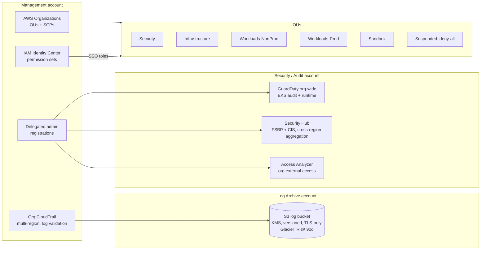

# aws-landing-zone-terraform

[](https://github.com/vince-cloud/aws-landing-zone-terraform/actions/workflows/ci.yml)


A multi-account AWS landing zone in Terraform: an OU structure, guardrail SCPs, an organization CloudTrail into a locked-down log archive, delegated GuardDuty / Security Hub / Access Analyzer, IAM Identity Center permission sets, and a per-account security baseline.

It's a personal reference implementation of the governance patterns I use for multi-account AWS estates working toward SOC 2-style controls. It can sit alongside AWS Control Tower or stand on its own. It contains no real account IDs, organization IDs or email addresses.

## Architecture



## Guardrails

| SCP | Attached to | Purpose |
|---|---|---|
| `deny-leave-org` | root | Accounts can't detach themselves from governance |
| `deny-root-user` | root | Root credentials are never used day to day |
| `protect-security-tooling` | root | CloudTrail, GuardDuty, Security Hub, Config and Access Analyzer can't be disabled, except by the break-glass role |
| `region-restriction` | workload, infra and sandbox OUs | Limits blast radius and data residency; global services exempt |
| `require-imdsv2` | workload and sandbox OUs | Blocks IMDSv1, a common SSRF-to-credentials path |
| `deny-all` | Suspended | Quarantine for accounts being closed |

Each template is tested in CI (`tests/test_scps.py`). The tests check that it renders to valid JSON, stays under the 5,120-character SCP limit, uses only Deny statements, and gives every statement a Sid.

## Design decisions

- **SCPs as rendered templates.** Policies are readable JSON files in Git, and regions and exempt roles are injected at plan time.
- **A break-glass exemption on one role only.** Guardrails can still be fixed in an incident, and every use shows up in CloudTrail.
- **The log archive lives in its own account,** and its bucket policy only accepts writes from CloudTrail scoped by `aws:SourceOrgID`. Workload admins can't tamper with audit evidence.
- **Security services run from a delegated admin,** so the management account stays nearly empty, as AWS recommends.
- **No IAM users.** People get short Identity Center sessions; PlatformAdmin is limited to 2 hours.
- **The account baseline is a separate module,** so a pipeline can stamp it into every new account: S3 account-level public access block, default EBS encryption, password policy, account analyzer and a budget.

## How to run

```bash
cd live
cp terraform.tfvars.example terraform.tfvars        # real account IDs stay local
terraform init -backend-config=../backend.hcl      # S3 + DynamoDB backend
terraform plan
```

Offline validation (what CI runs):

```bash
terraform fmt -recursive -check
tflint --init && tflint --recursive
(cd live && terraform init -backend=false && terraform validate)
pytest -q tests
```

## What this demonstrates

- Multi-account AWS governance: OUs, SCPs, delegated administration
- Centralized, tamper-resistant audit logging
- Org-wide threat detection and posture management (GuardDuty, Security Hub with CIS and FSBP)
- Zero-standing-privilege access with Identity Center
- Testing policy-as-code in CI

## License

MIT
